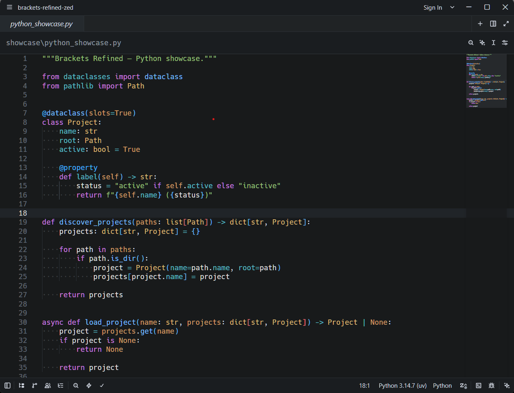
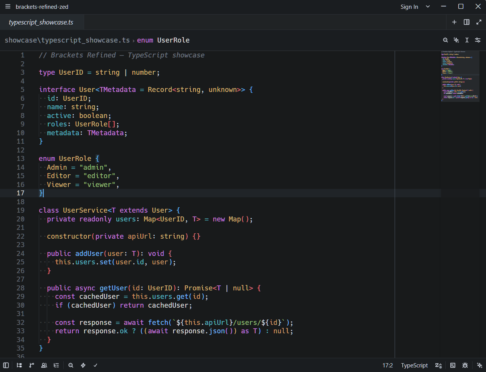
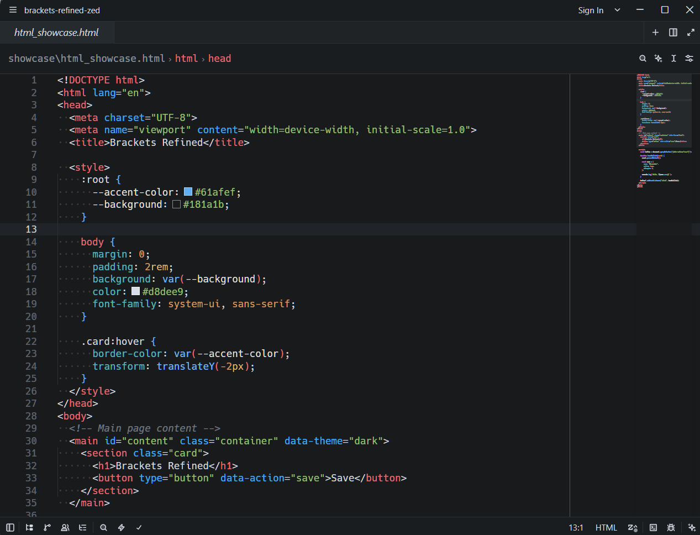

# Brackets Refined

A dark theme extension for [Zed](https://zed.dev/) with two variants and balanced, expressive syntax palettes.

## About

**Brackets Refined** preserves the clean, focused character associated with Brackets while adapting its visual language to Zed's modern interface and syntax highlighting system.

The extension includes two variants:

- **Brackets Refined - Classic** — the original neutral dark theme, with a near-black `#181A1B` editor background.
- **Brackets Refined - Arctic** — a darker theme with a cool color palette and a `#0D0E11` editor background.

Both variants use restrained UI contrast, muted secondary text, and a compact set of syntax colors chosen to keep code structure easy to scan without making the editor visually noisy.

## Screenshots

### Python



### TypeScript



### HTML & CSS



## Key Features

- Two dark variants: neutral Classic and cooler, darker Arctic
- Low-distraction workbench surfaces matched to each variant
- Clear active, hover, selection, and focus states
- Balanced syntax highlighting for functions, types, parameters, properties, strings, and constants
- Extended semantic syntax highlighting for function and method definitions and calls, built-in and member variables, additional type and constant categories, documentation, and configuration files
- Coordinated diagnostics, Git, diff, and debugger colors
- Complete terminal ANSI palette
- Minimap and scrollbar states matched to the UI palette
- Markdown and embedded-language highlighting
- Tested with Python, Markdown, CSS, HTML, JavaScript, and TypeScript

The extended highlighting uses each variant's existing palette. Which distinctions appear depends on the syntax and semantic information provided by the language grammar and language server in Zed.

## Classic Syntax Palette

| Element | Color |
| --- | --- |
| Functions & Methods | `#74B9FF` |
| Types, Classes & Interfaces | `#E5C07B` |
| Keywords | `#C678DD` |
| Type Parameters | `#C678DD` |
| Namespaces & Modules | `#56B6C2` |
| Properties | `#56B6C2` |
| Parameters | `#D19A66` |
| Numbers & Constants | `#D19A66` |
| Variables | `#E8E8E8` |
| Strings | `#98C379` |
| Tags | `#E06C75` |
| Attributes & Decorators | `#3FA9F5` |
| Comments | `#8C8C8C` *italic* |

## Installation

**Brackets Refined** is available from Zed's Extensions catalog.

1. Open Zed.
2. Open **Extensions**.
3. Search for **Brackets Refined**.
4. Click **Install**.
5. Open the Theme Selector and select **Brackets Refined - Classic** or **Brackets Refined - Arctic**.

### Upgrading to 0.1.2

The original **Brackets Refined** theme has been renamed to **Brackets Refined - Classic**. Existing users may need to select it again in the Theme Selector after updating. Choose **Brackets Refined - Arctic** to use the new darker, cool-toned variant.

See the [Changelog](CHANGELOG.md) for version history.

### Development Installation

Clone this repository, open Zed's Extensions view, choose **Install Dev Extension**, and select the repository root — the directory containing `extension.toml`.

## Development

Both Zed theme variants are defined in:

```text
themes/brackets-refined.json
```

After changing the theme, use **Rebuild** for the development extension in Zed's Extensions view to reload it.

### Contrast Audit

With Python 3.11 or newer, run from the repository root:

```sh
python scripts/check_contrast.py
```

The read-only audit uses no third-party dependencies and reports contrast ratios, thresholds, PASS/WARN/FAIL results, and totals separately for each theme variant. It checks UI text, line numbers, syntax, and terminal colors using WCAG 2.1 relative luminance. All syntax colors, including comments, are checked against both the editor and active-line backgrounds at 4.5:1.

Low contrast in muted UI text, line numbers, code lenses, dim terminal colors, and black ANSI entries produces WARN; decorative guides use an advisory 3:1 threshold. Other text checks use a critical 4.5:1 threshold. Warnings are project policy, not WCAG exemptions. Transparent HEX colors are composited over their background layers in sRGB; the root background must be opaque. The audit covers configured color pairs, not every Zed rendering state or terminal application's custom colors.

Exit codes: `0` for no critical failures (warnings are allowed), `1` for critical contrast failures, and `2` for file or theme-data errors.

Equivalent terminal backgrounds are checked once per foreground key. Detailed syntax checks remain separate for every key and background; a supplementary summary groups problems by their effective foreground/background colors.

## Acknowledgements

Brackets Refined is an independent theme for Zed inspired by the visual style and syntax highlighting of the Brackets code editor.

Thanks to the Brackets and Zed communities and their contributors for the tools, documentation, and ecosystem that made this theme possible.

This project is not affiliated with, endorsed by, or sponsored by Adobe, the Brackets project, or Zed Industries.

## License

Brackets Refined is released under the MIT License. See [LICENSE](LICENSE).
